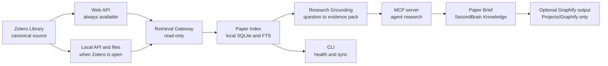

# Zotero Research Bridge Design

**Status:** Accepted and implemented
**Date:** 2026-07-21

## Goal

Make the full Zotero Library automatically available for evidence-grounded agent conversations and process every
eligible research record into a durable, provenance-safe SecondBrain artifact. `SecondBrain Queue` is the priority
lane, not the long-term boundary.

## Verified starting point

- Zotero Web API authentication works for the personal library.
- The library contains 2,918 total items, 1,730 attachments, and 1,201 PDF attachments.
- Zotero reports 809 full-text index records; 802 correspond to current non-trashed attachments.
- The desktop local API and Better BibTeX endpoint are available only while Zotero is running; Zotero was closed during inspection.
- `zotero-research-library-pp-cli.exe` 0.1.0 is installed and authenticates successfully, but only `auth`, `doctor`, and `sync` are registered. Its modified development binary has no recoverable source tree or local cache and will not be extended.
- The current Zotero API key can read library files but also has write permission. Production setup requires a separate read-only key.
- SecondBrain is available at `C:\Users\eric_rash\Desktop\SecondBrain` and treats `Knowledge/` as the home for ingested external reference material.
- SportScienceResearchRepo is a separate deployed, curated public browser and is not a canonical research or knowledge store.

## System shape

## Architectural decisions

1. Zotero owns citations, metadata, PDFs, annotations, collections, and tags.
2. SecondBrain owns derived Paper Briefs and later Synthesis Articles.
3. Every eligible Source Paper belongs to a resumable processing backlog. `SecondBrain Queue` receives priority;
   the configured promotion scope controls whether the queue or full library is eligible.
4. Agents never mutate Zotero. All Zotero requests are restricted to `GET` or `HEAD`.
5. The Web API provides always-available metadata and indexed text. The local API and local attachment paths provide richer evidence access while Zotero is open.
6. `zotero.sqlite` is never read directly.
7. A Paper Brief requires Usable Full Text and page- or section-level Evidence Locators. Otherwise the output is a Reference Stub.
8. MCP is the conversational interface shared by Codex, Claude Code, and Antigravity. The CLI is the operational
   interface. A Zotero plugin is not part of version one.
9. Normal domain questions use Zotero-first multi-query retrieval. Coverage includes explicit sport, sex, age,
   competition-level, and injury-context alignment; thin local coverage triggers a clearly labeled external
   peer-reviewed fallback through the active harness.
10. The research corpus is retrieval memory. It complements, but does not replace or bulk-populate, existing
    personal, project, and workflow memory systems.

## Implementation

### Reproducible core

Build a Python 3.12 package managed by `uv`. Python is preferred because the official MCP SDK supports Python 3.10+, PyMuPDF provides page-aware extraction, and the standard SQLite build supports a compact local full-text index.

The package will expose the same application services through:

- a stdio MCP server for Codex, Claude Code, and Antigravity;
- a CLI for configuration, health checks, synchronization, queue inspection, and validation.

### Local state

Store disposable state outside both repositories under `%LOCALAPPDATA%\zotero-research-bridge\`:

- `library.db`: normalized Zotero metadata, collections, tags, attachment metadata, full-text search, library version, and Promotion Records;
- `evidence-cache/`: temporary page-aware extraction keyed by attachment version and hash;
- `batches/<batch-id>.json`: atomic, human-readable item-key manifests with pinned Zotero versions, extraction
  outcomes, blockers, and Promotion Record paths and hashes;
- logs containing item keys and outcomes but never API keys or full paper text.

The Paper Index is rebuildable from Zotero and is not committed to Git.

### Incremental synchronization

Use Zotero library and object versions, `Last-Modified-Version`, `If-Modified-Since-Version`, and `?since=` to fetch only changes after the initial sync. Deletions remove derived cache rows but never automatically delete an existing SecondBrain article; they instead raise a provenance warning for review.

### Attachment and evidence resolution

For a selected parent item, resolve PDF attachments in this order:

1. Zotero local API file URL when Zotero is running;
2. Zotero Web API file download for stored attachments;
3. configured local linked-file path when exposed by the local API;
4. no automatic arbitrary-URL download in version one.

Use Zotero's indexed full text for discovery and search. Use the PDF itself for Paper Brief evidence so page locators remain verifiable. Do not copy PDFs into SecondBrain.

### Agent tools

The MCP surface is intentionally small:

- `zotero_health`: authentication, API availability, queue presence, cache freshness, and read-only-key verification;
- `sync_zotero_library`: incremental read-only synchronization into the Paper Index;
- `search_papers`: metadata and full-text search with domain, year, author, tag, collection, and full-text filters;
- `get_paper`: citation, abstract, identifiers, collections, tags, attachments, and promotion status;
- `search_paper_evidence`: short page-located passages relevant to a question;
- `get_paper_pages`: bounded page text for close study, never an unbounded whole-library dump;
- `list_promotion_queue`: selected papers and readiness/blocking reasons;
- `list_library_backlog`: all eligible research records with priority and resumable processing state;
- `build_research_evidence_pack`: normal question to ranked local citations, evidence, and coverage status;
- `prepare_paper_brief`: metadata, section map, evidence readiness, and deterministic destination;
- `save_paper_brief`: validate and atomically write a conforming Paper Brief or Reference Stub without changing Zotero.

The CLI exposes parallel commands including `doctor`, `sync`, `search`, `ground`, `show`, `queue`, `backlog`,
`batch-create`, `batch-run`, `batch-status`, `prepare`, and `serve-mcp`.

### Promotion workflow

1. The derived backlog selects the next eligible Source Paper; `SecondBrain Queue` records receive priority.
2. `batch-create` freezes a bounded set of item keys and Zotero versions so later library changes cannot silently
   alter the work unit.
3. `batch-run` resumes the manifest and atomically checkpoints each item as pending, ready, Reference Stub
   candidate, failed, version-changed, update-available, or ingested.
4. Synchronization observes item versions and promotion provenance without requiring collection cleanup.
5. The gateway resolves the best PDF attachment and checks Usable Full Text.
6. If full text is inadequate, the agent may create only a Reference Stub.
7. If full text is usable, the agent reviews page-aware evidence and prepares the Paper Brief.
8. The validator requires the Paper Brief contract and checks every claimed Evidence Locator against extracted pages.
9. The writer saves atomically to `SecondBrain\Knowledge\library\research-papers\<author-year-short-title>.md` and reports the exact change.
10. A subsequent batch run reconciles the Promotion Record into the ledger, including artifact path and content
    hash. Completed extraction work is skipped; item-version drift fails closed and requires a new batch.
11. The working agent reviews and commits the SecondBrain change according to the vault convention; the bridge will not silently create Git commits.

Repeated processing is idempotent. Zotero item key is the primary identity; DOI and citekey are secondary match keys. A changed Zotero version produces an update review rather than a duplicate file.

### Harness model routing

The bridge is model-agnostic. During full-library batch processing, the shared harness skill routes bounded
operations to GPT-5.6 Terra at high reasoning and reserves GPT-5.6 Sol at high reasoning for full-text scientific
review, applicability judgment, Evidence Locator selection, Paper Brief writing, and final scientific approval.
Model-routed stages run sequentially with one writer per batch ledger, Promotion Record, and SecondBrain artifact.
If a harness cannot select worker models, it completes the batch with its current model and reports that no switch
occurred. See [ADR 0010](./adr/0010-use-tier-aware-model-routing-for-library-batches.md).

## SecondBrain and graph boundaries

- Paper Briefs live together under `Knowledge/library/research-papers/`; domain and topic live in frontmatter rather than duplicating a paper across folders.
- Existing citation-only notes can be upgraded from Reference Stub to Paper Brief when matched by DOI, Zotero key, or verified citation identity.
- Synthesis Articles are separate artifacts that cite multiple Paper Briefs.
- Graphify may process reviewed briefs to discover clusters, contradictions, bridges, and candidate synthesis
  questions. Extracted, inferred, and ambiguous edges retain their labels; graph relationships are never primary
  evidence. Generated graph artifacts remain under `SecondBrain/Projects/Graphify/ZoteroResearchBridge/`, never
  mixed into general Knowledge.
- SportScienceResearchRepo receives no automatic writes. A reviewed export may wrap a current Paper Brief,
  Zotero version, full-text readiness, Evidence Locators, 13-field public synthesis content, and controlled
  taxonomy in a versioned `READY_FOR_LIBRARY_REVIEW` candidate. SportScienceResearchRepo remains responsible
  for duplicate review, reviewer approval, stable ID assignment, and publication.

## Security and integrity

- Require a dedicated Zotero API key with personal-library read and file access but no write permission.
- Accept credentials through environment variables or a user-local configuration file excluded from Git.
- Enforce an HTTP method allowlist of `GET` and `HEAD` even if a broader key is accidentally configured.
- Keep full paper text and PDF caches local and uncommitted.
- Return bounded evidence snippets through MCP to control context use and avoid redistributing papers.
- Label Practitioner Interpretation separately from study findings.
- Preserve population, design, outcome, and limitation context around every applied claim.

## Why no Zotero plugin yet

A plugin would add value only for native Zotero interaction: a promotion button, visible processing status, validation warnings, or immediate event notifications. It would not replace the Retrieval Gateway, Paper Index, evidence extraction, MCP tools, or SecondBrain writer.

Reconsider a plugin only if at least one of these becomes a repeated burden:

- users need an in-Zotero action to change priority or request promotion;
- users need promotion state visible inside Zotero;
- polling or manual synchronization causes missed changes;
- an essential read capability is unavailable through supported APIs.

## Manual prerequisites for implementation

The user will need to perform two Zotero-side actions when implementation reaches integration testing:

1. Create the `SecondBrain Queue` collection.
2. Create a dedicated API key with personal-library read and file access and no write permission.

No credentials belong in this repository.

## Primary technical references

- [Zotero Web API basics](https://www.zotero.org/support/dev/web_api/v3/basics)
- [Zotero Local API](https://www.zotero.org/support/dev/web_api/v3/local_api)
- [Zotero full-text content requests](https://www.zotero.org/support/dev/web_api/v3/fulltext_content)
- [Zotero incremental syncing](https://www.zotero.org/support/dev/web_api/v3/syncing)
- [Zotero attachment file API](https://www.zotero.org/support/dev/web_api/v3/file_upload)
- [Official MCP Python SDK](https://github.com/modelcontextprotocol/python-sdk)
- [MCP server guide](https://modelcontextprotocol.io/docs/develop/build-server)
